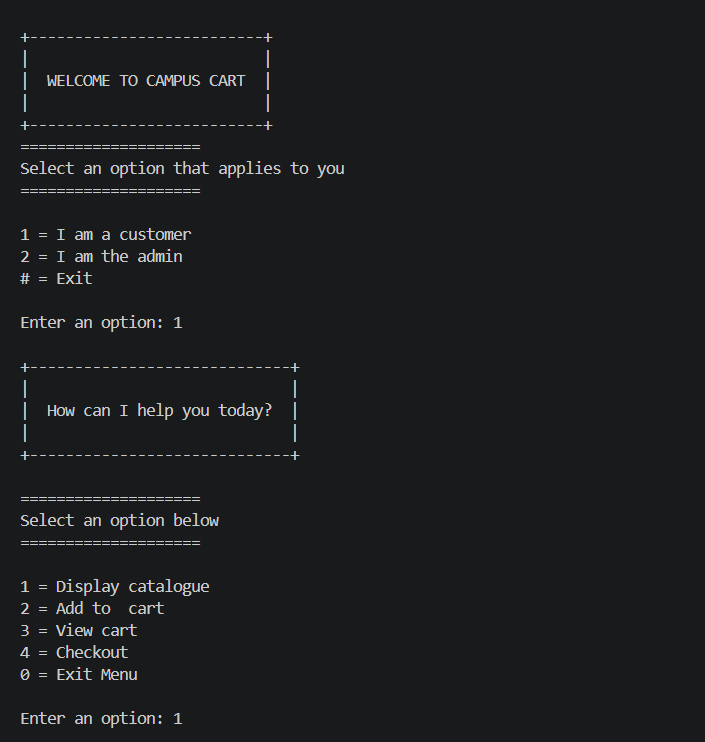
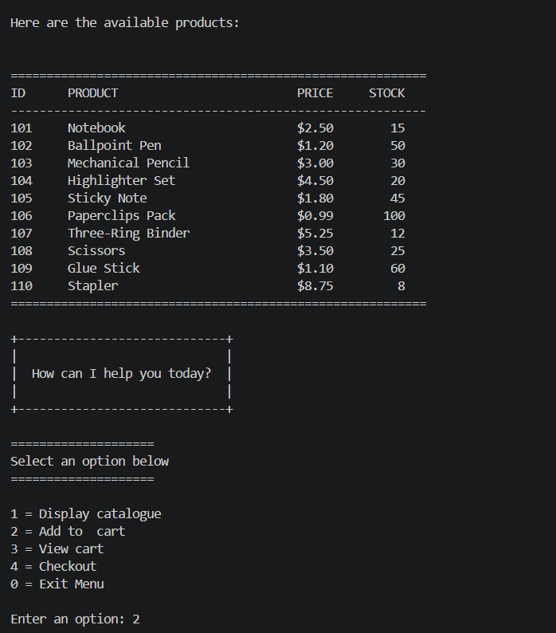
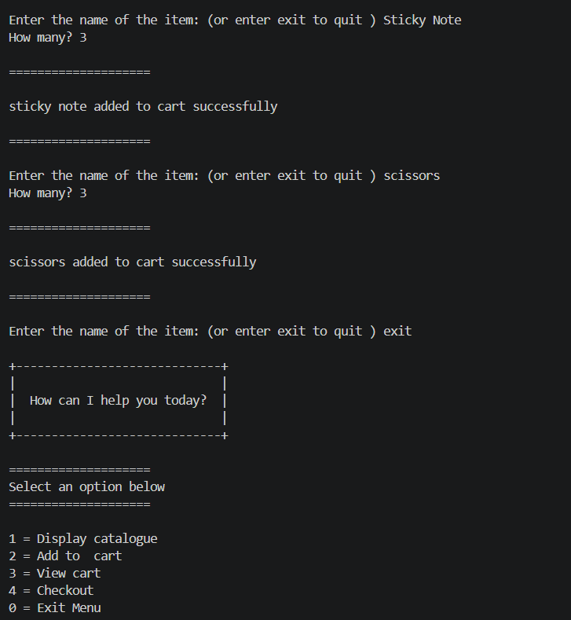
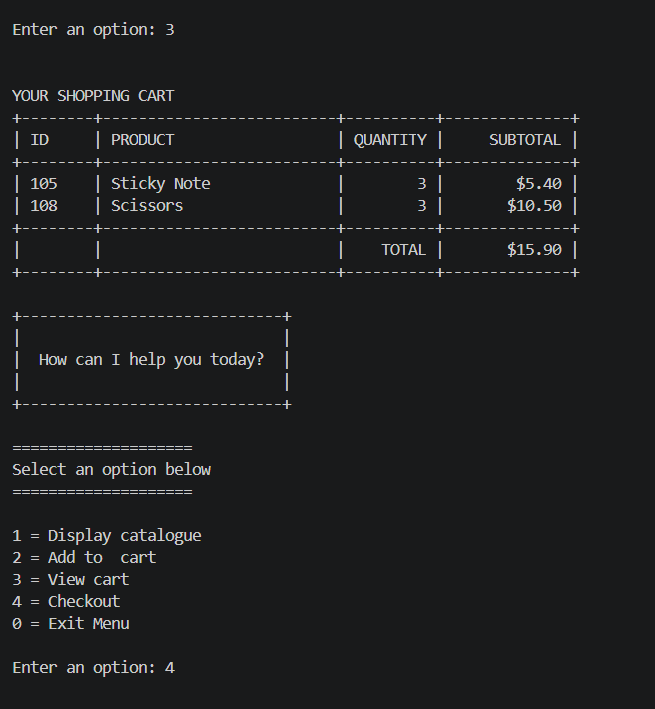
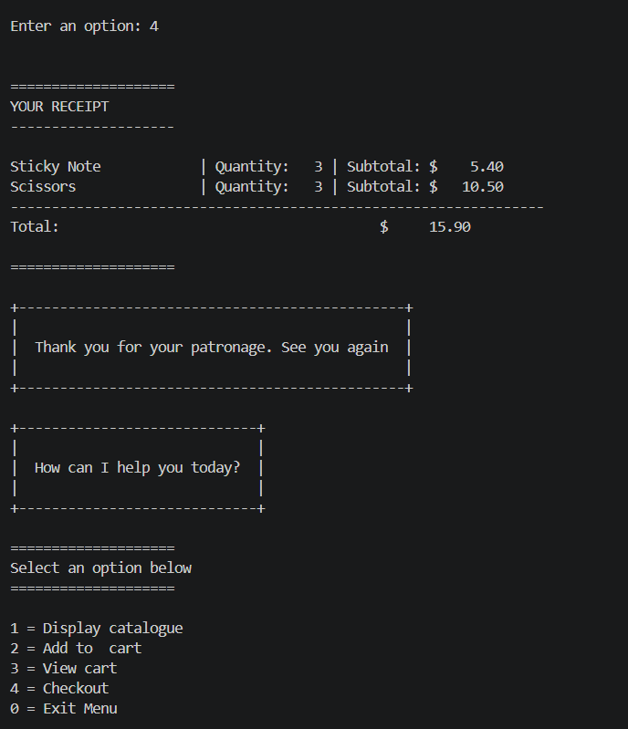

# CAMPUSCART

CampusCart is an interactive command-line shopping and inventory application for campus vendors. It provides separate customer and administrator menus, allowing customers to browse products and complete purchases while administrators maintain the store's inventory. Every checkout is recorded in a transaction log.

## Overview

Campus vendors often rely on handwritten stock records and manual checkout calculations. CampusCart demonstrates how a lightweight Python program can bring common sales tasks into one keyboard-driven interface without requiring dedicated point-of-sale hardware.

The current version is organised into separate modules and uses Python variables, conditionals, loops, functions, dictionaries, lists, decorators, file handling, unit tests, and formatted terminal output.

## Problem Statement

CampusCart is designed to address several common problems faced by small campus vendors:

- **Manual inventory tracking:** Paper records can become inaccurate, especially during busy periods.
- **Slow checkout:** Manually calculating item totals, discounts, and tax can delay customers.
- **Stock-control errors:** Without an immediate stock check, a vendor may attempt to sell more units than are available.
- **Unclear purchase summaries:** Customers benefit from seeing their selected items, quantities, subtotals, and final total in a consistent format.
- **No sales record:** Without a written history, it is hard to review what was sold and when.

## Target Audience

- **Student entrepreneurs** operating dorm-based snack shops, stationery stores, clothing thrifts, or printing services.
- **On-campus kiosk operators** managing small coffee carts, juice bars, or stationery stands.
- **Club and society treasurers** selling merchandise, event tickets, or food during campus activities.

## Key Value Proposition

CampusCart provides a simple checkout and inventory workflow in the terminal. Customers can build a cart using item names or product IDs, and every purchase is saved to a transaction log. Administrators can restock, add, and remove products and check which items are running low, all without editing the code while the program is running.

## Current Features

### Customer features

- Display the product catalogue, sorted by price from lowest to highest, with product IDs, names, prices, and available stock.
- Add products to the cart by entering the product name or ID.
- Add more units of a product already in the cart.
- Prevent cart quantities from exceeding the available stock.
- Remove some or all units of an item from the cart.
- View an itemised cart with a subtotal.
- Check out and receive a receipt.
- Apply a 10% discount automatically when the order subtotal is greater than `$20.00`.
- Add 7.5% tax to the final total.
- Re-check stock at checkout. If an item is no longer available in the requested quantity, the checkout is refused and the cart is kept so it can be adjusted.
- Reduce inventory quantities after a successful checkout and clear the cart.
- Reject invalid quantities (such as letters or zero) without stopping the program.

### Administrator features

- Protect the admin menu with a password (see [Password Setup](#password-setup)).
- Display the current inventory.
- Run a low-stock report for items below a chosen quantity.
- Restock an existing product by adding units.
- Add a new product with an ID, name, price, and stock quantity.
- Delete a product from the inventory.

### Transaction logging

- Every checkout attempt is written to `transactions.txt` automatically through a decorator in `logger.py`.
- Each entry records the transaction ID, date, time, status (`SUCCESS`, `FAILED`, or `ERROR`), message, items bought, number of unique items and total units, subtotal, final total, and processing time.
- Failed checkouts (for example, not enough stock) are logged too, so there is a complete history.

## Project Structure

| File             | Purpose                                                                                                                                              |
| ---------------- | ---------------------------------------------------------------------------------------------------------------------------------------------------- |
| `main.py`        | The command-line interface. Run this file to start the app.                                                                                          |
| `inventory.py`   | Inventory functions: stock checks and updates, adding and deleting products, price calculation, low-stock filtering, and sorted catalogue display.   |
| `cart.py`        | Cart functions: adding and removing items, subtotal calculation, and receipt lines.                                                                  |
| `checkout.py`    | The `checkout` function: validates stock, calculates the final total, updates inventory, and clears the cart. It is wrapped by the logger decorator. |
| `logger.py`      | The `log_transaction` decorator that writes each checkout to `transactions.txt`.                                                                     |
| `test_logger.py` | Unit tests for the logger.                                                                                                                           |

All files must be in the same folder.

## Requirements

- Python 3.12 or later
- A terminal or command prompt
- No third-party packages are required

## Password Setup

The admin section needs a password, which is read from an environment
variable called ADMIN_PASSWORD. Set it in the same terminal where you
will run the app.

**Windows (PowerShell):**
$env:ADMIN_PASSWORD="your-password"

**Windows (Command Prompt):**
set ADMIN_PASSWORD=your-password

**Mac/Linux:**
export ADMIN_PASSWORD="your-password"

Then run:
python main.py

This lasts only for the current terminal window. If you open a new
terminal, set it again.

### Optional: make it permanent

**Windows:**

1. Run this once:
   setx ADMIN_PASSWORD "your-password"
2. Close ALL VS Code windows completely. Closing only the terminal
   panel is not enough, because VS Code reads environment variables
   only when it starts.
3. Reopen VS Code and open a new terminal.
4. Check that it worked:
   - PowerShell: echo $env:ADMIN_PASSWORD
   - Command Prompt: echo %ADMIN_PASSWORD%
     If it prints your password, you're ready to run: python main.py

Note: `setx` does not change the terminal you ran it in. It only
applies to terminals and programs opened afterward. If the app still
says "Admin password not set" after restarting VS Code, restart your
computer.

**Mac/Linux:**
Add this line to ~/.bashrc or ~/.zshrc, then open a new terminal:
export ADMIN_PASSWORD="your-password"

## Transaction Log

The first checkout creates a file called `transactions.txt` in the folder you run the app from. Later checkouts add new entries to the end of the same file; nothing is overwritten. To start a fresh log, delete the file.

Example entry:

```
============================================================
Transaction ID : 87ADF45E
Date           : 2026-10-31
Time           : 05:59:46
Status         : SUCCESS
Message        : Payment successful.
------------------------------------------------------------
Items Bought:
  [101] Notebook | 2 x $2.50 = $5.00
  [110] Stapler | 2 x $8.75 = $17.50
------------------------------------------------------------
Unique Items   : 2
Total Units    : 4
Subtotal       : $22.50
Total (final)  : $21.78
Processing Time: 0.0000s
============================================================
```

The log contains purchase records, so if you use Git, add `transactions.txt` to your `.gitignore` file to keep it out of the repository.

## Running the Tests

The logger has a unit test suite. From the project folder, run:

```
python -m unittest test_logger -v
```

The tests write to a temporary file, so your real `transactions.txt` is not touched.

## ASCII CLI MOCKUP

The mockup below reflects the options available in the current CampusCart program.

```
+--------------------------+
|                          |
|  WELCOME TO CAMPUS CART  |
|                          |
+--------------------------+

1 = I am a customer
2 = I am the admin
# = Exit

Enter an option: 1

--- How can I help you today? ---
1 = Display catalogue
2 = Add to cart
3 = View cart
4 = Remove from cart
5 = Checkout
0 = Exit Menu

Enter an option: 1

--- Product Catalog (Ascending (Low to High)) ---

ID     | Item Name                 | Price      | Stock
-------------------------------------------------------
106    | Paperclips Pack           | $0.99      | 100
109    | Glue Stick                | $1.10      | 60
102    | Ballpoint Pen             | $1.20      | 50
105    | Sticky Note               | $1.80      | 45
101    | Notebook                  | $2.50      | 15
103    | Mechanical Pencil         | $3.00      | 30
108    | Scissors                  | $3.50      | 25
104    | Highlighter Set           | $4.50      | 20
107    | Three-Ring Binder         | $5.25      | 12
110    | Stapler                   | $8.75      | 8
-------------------------------------------------------

Enter an option: 2
Enter the item name or ID: Notebook
How many? 2
2 x Notebook added to cart.

Enter an option: 2
Enter the item name or ID: 110
How many? 2
2 x Stapler added to cart.

Enter an option: 3

Notebook (x2) - $5.00
Stapler (x2) - $17.50
Subtotal: $22.50

Enter an option: 5

=== YOUR RECEIPT ===
Notebook (x2) - $5.00
Stapler (x2) - $17.50
Subtotal: $22.50
Total (after discounts & tax): $21.78
Thank you for your patronage. See you again!

Enter an option: 0

Enter an option: 2
Admin password: ********
Welcome back, Admin.

--- Admin Menu ---
1 = Display inventory
2 = Low stock report
3 = Restock a product
4 = Add new product
5 = Delete a product
0 = Exit Menu

Enter an option: 2
Show items with stock below: 10

--- Low Stock Alert Report ---

Item ID  | Item Name                 | Price      | Stock Remaining
--------------------------------------------------------------------
110      | Stapler                   | $8.75      | 6
--------------------------------------------------------------------

Enter an option: 3
Enter the product ID: 110
How many units to add? 20
Successfully added 20 units! New stock: 26

Enter an option: 4
New product ID: 111
Product name: Correction Tape
Price: $2.75
Stock quantity: 20
Successfully added 'Correction Tape' (ID: 111) to inventory!

Enter an option: 0

Enter an option: #
Goodbye!
```

## Flow of a Successful Purchase

### Available Options



### Display Catalogue



### Add to Cart



### View Cart



### Checkout



## Limitations

The current version does not yet provide:

- Permanent storage for the inventory (product changes are lost when the program closes; only the transaction log is saved to a file)
- Individual administrator accounts (there is a single shared admin password)
- Updating the price of an existing product
- A searchable receipt history or a way to view the log inside the app
- Payment-method processing
- Sales analytics or revenue reports
- Configurable currency, tax rate, or discount settings

These items are in the works for future development, but they are not part of the present program.

## Future Improvements

- Save inventory data in JSON, CSV, or a database so changes persist between sessions.
- Restore the option to update a product's price.
- View and search the transaction history from inside the app.
- Add daily and weekly sales reports built from the transaction log.
- Support configurable taxes, discounts, and currencies.
- Add unit tests for the cart, inventory, and checkout modules.

## Author

**Oluwatomisin Tomoloju**
